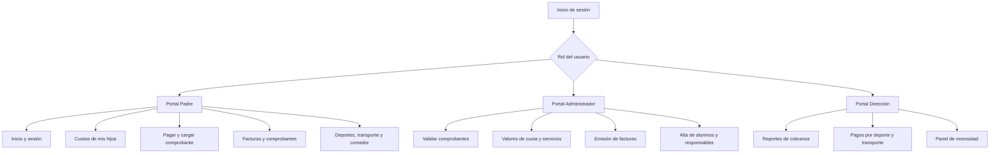
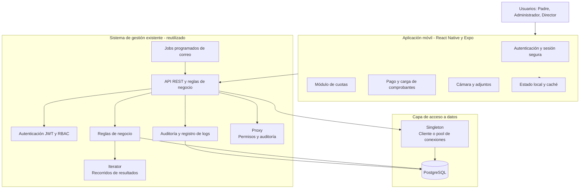
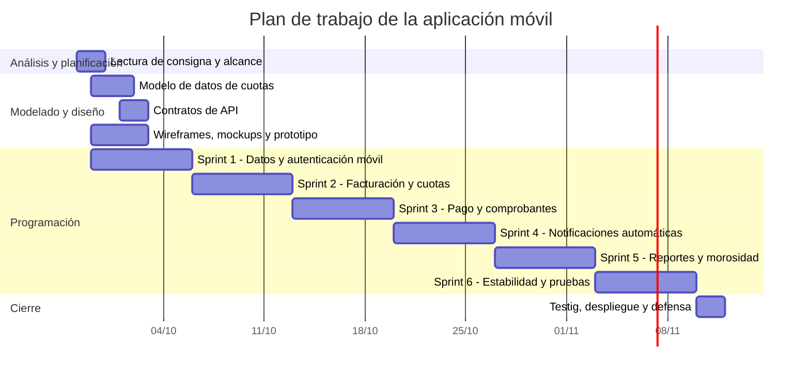
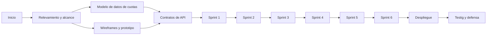

  

    
    
  

  

    <h1>Plan de Trabajo - Proyecto</h1>
    <h2>Centro Educativo "EDUCAR PARA TRANSFORMAR"</h2>
    <h3>Aplicación Móvil de Gestión de Cuotas</h3>
    
Tecnicatura Universitaria en Programación

    
<strong>Equipo de trabajo</strong>

    
Hakanson, Ian Morales, Elías

  

  <h1>Índice</h1>
  <ul class="index-list">
    <li><a href="#1-descripción-del-proyecto">1. Descripción del Proyecto</a></li>
    <li><a href="#2-objetivos-del-proyecto">2. Objetivos del Proyecto</a></li>
    <li><a href="#3-cronograma-de-actividades---aplicación-móvil">3. Cronograma de Actividades - Aplicación Móvil</a></li>
    <li><a href="#4-diagrama-de-gantt">4. Diagrama de Gantt</a></li>
    <li><a href="#5-diagrama-de-pert">5. Diagrama de PERT</a></li>
    <li><a href="#6-backlog-de-los-sprints">6. Backlog de los Sprints</a></li>
    <li><a href="#7-plan-de-sprint">7. Plan de Sprint</a></li>
    <li><a href="#8-entregables">8. Entregables</a></li>
    <li><a href="#9-referencias">9. Referencias</a></li>
  </ul>

# Plan de Trabajo - Proyecto

## Centro Educativo "EDUCAR PARA TRANSFORMAR"

### Aplicación Móvil de Gestión de Cuotas

## Nombre del Equipo de Trabajo

**Equipo de desarrollo de la aplicación móvil de gestión educativa**

## Apellido y Nombre del Equipo de Trabajo

- Hakanson, Ian
- Morales, Elías

---

# 1. Descripción del Proyecto

## 1.1 Problema

El centro educativo privado "EDUCAR PARA TRANSFORMAR", ubicado en las afueras de la ciudad de Resistencia, iniciará sus actividades en marzo de 2027. En la etapa anterior se desarrolló un sistema de gestión web con portales diferenciados para alumnos, padres, docentes, administradores y Dirección, que ya centraliza la información académica, deportiva y de servicios (Centro Educativo EDUCAR PARA TRANSFORMAR, 2026).

Ese sistema cubre las inscripciones a deportes, transporte y comedor, pero no cubre la dimensión económica del centro educativo: **el cobro de cuotas mensuales, la emisión de facturas, la carga de comprobantes de transferencia bancaria y la consulta de deudas**. Actualmente esa gestión es manual, se apoya en planillas y recordatorios enviados a mano, y depende de que un administrador copie datos de un documento a otro.

El comprobante de pago es hoy el punto de mayor fricción: los padres deben efectuar una transferencia, avisar por otros medios y esperar a que alguien registre el pago. Esto genera demora en la acreditación, duplica registros y vuelve imposible saber con precisión quién debe qué al cierre de cada mes.

La consigna de la cátedra propone resolverlo con una **aplicación móvil** que centralice cuotas, comedor, deportes y transporte, reutilizando la base de datos y los servicios del sistema ya existente para evitar duplicación e inconsistencias (Cátedra de Metodología de Sistemas II, 2026). El desafío adicional de esta etapa es desarrollar con ayuda de Inteligencia Artificial, siendo los estudiantes responsables de comprender, verificar y justificar todo lo que la herramienta genere.

## 1.2 Alcance del Proyecto

Este plan cubre exclusivamente la **aplicación móvil y las extensiones necesarias sobre el sistema existente** para soportarla.

**Dentro del alcance:**

- Modelado de datos de cuotas, tarifas, facturas, comprobantes y pagos.
- Extensión de la API existente con los endpoints de facturación, pagos y cobranza.
- Módulo de autenticación de la aplicación móvil.
- Módulo de gestión de cuotas de la aplicación móvil.
- Módulo de notificaciones automáticas por correo.
- Módulo de reportes de pagos en la aplicación web.
- Funcionalidad adicional de valor: panel de morosidad.
- Informe de uso de la Inteligencia Artificial y bitácora de IA.
- Pruebas, documentación y defensa del proyecto.

**Fuera del alcance:**

- La implementación de la página web institucional (Parte 1 de la consigna).
- Los portales del sistema de gestión ya entregados: alumnos, padres, docentes, administrador y Dirección (Parte 2 de la consigna).
- La reimplementación del backend, de la base de datos, del motor de reportes, del módulo de auditoría, de la autenticación o de los patrones de diseño ya construidos. La aplicación móvil **consume** esos componentes; sólo los extiende.

## 1.3 Requerimientos Funcionales

### Módulo 1 - Autenticación

- **RF-MV-01 - Inicio de sesión:** La aplicación debe permitir al usuario autenticarse con sus credenciales y obtener acceso a la aplicación.
- **RF-MV-02 - Cierre de sesión:** La aplicación debe permitir al usuario cerrar su sesión e invalidar el acceso local.
- **RF-MV-03 - Recuperación y cambio de contraseña:** La aplicación debe permitir al usuario recuperar y cambiar su contraseña, si la infraestructura existente lo permite.
- **RF-MV-04 - Control de acceso por rol:** La aplicación debe mostrar y habilitar únicamente las funcionalidades correspondientes al rol del usuario autenticado.
- **RF-MV-05 - Aislamiento de datos por hijo:** La aplicación debe permitir al padre acceder exclusivamente a la información de sus hijos asociados y a sus inscripciones a deportes, transporte y comedor.

### Módulo 2 - Gestión de Cuotas (aplicación móvil)

- **RF-MV-06 - Consulta de cuotas pendientes:** La aplicación debe permitir consultar las cuotas pendientes de pago, con su importe, vencimiento y estado.
- **RF-MV-07 - Consulta de cuotas pagadas:** La aplicación debe permitir consultar las cuotas pagadas y sus comprobantes.
- **RF-MV-08 - Consulta de vencimientos:** La aplicación debe permitir identificar las cuotas vencidas.
- **RF-MV-09 - Historial de pagos:** La aplicación debe permitir consultar el historial de pagos del alumno.
- **RF-MV-10 - Listado de facturas y comprobantes por período:** La aplicación debe permitir listar las facturas y los comprobantes asociados a un alumno dentro de un período de fechas.
- **RF-MV-11 - Historial de deuda por ítem:** La aplicación debe permitir consultar el historial de deuda discriminado por cada ítem de pago (cuota, deporte, transporte y comedor).
- **RF-MV-12 - Selección de ítems a pagar:** La aplicación debe permitir al padre seleccionar los ítems a pagar e informar el total a abonar con su composición.
- **RF-MV-13 - Datos de transferencia:** La aplicación debe mostrar los datos bancarios necesarios para efectuar la transferencia.
- **RF-MV-14 - Carga de comprobante:** La aplicación debe permitir al padre cargar el comprobante de la transferencia, en imagen o PDF, asociado a la factura correspondiente.
- **RF-MV-15 - Validación de comprobantes:** La aplicación debe permitir al administrador aprobar o rechazar un comprobante cargado, y al sistema emitir el comprobante de pago definitivo cuando la aprobación corresponde.

### Módulo 3 - Notificaciones automáticas

- **RF-MV-16 - Recordatorio mensual:** El sistema debe enviar por correo, el último día hábil de cada mes y a cada padre, el recordatorio del total que debe abonar, detallando la composición de ese valor y adjuntando la factura.
- **RF-MV-17 - Aviso de deuda mensual:** El sistema debe enviar por correo, el día 20 de cada mes y a cada padre con pago incompleto, el detalle de su deuda.

### Módulo 4 - Configuración de valores y facturación

- **RF-MV-18 - Valores por el administrador:** El sistema debe permitir al administrador especificar el valor de la cuota, de los deportes y de los servicios de transporte y comedor.
- **RF-MV-19 - Emisión de facturas:** El sistema debe emitir la factura mensual de cada alumno con el detalle de sus ítems de cobro.

### Módulo 5 - Reportes de pagos (aplicación web)

- **RF-MV-20 - Ingresos por período:** El sistema debe permitir listar los ingresos por período de tiempo.
- **RF-MV-21 - Pagos completos por período:** El sistema debe permitir listar los pagos completos realizados por período de tiempo, discriminados por año y por alumno al que corresponden.
- **RF-MV-22 - Pagos incompletos por período:** El sistema debe permitir listar los pagos incompletos realizados por período de tiempo, discriminados por año y por alumno al que corresponden.
- **RF-MV-23 - Pagos por deporte:** El sistema debe permitir listar los pagos de alumnos por deporte, nivel, horario y profesor a cargo.
- **RF-MV-24 - Pagos por recorrido de transporte:** El sistema debe permitir listar los pagos de alumnos por recorrido del servicio de transporte.

### Módulo 6 - Desafío: panel de morosidad (funcionalidad agregada)

- **RF-MV-25 - Indicadores de morosidad:** La aplicación debe permitir consultar la evolución de la cobranza, los alumnos con mayor atraso y un pronóstico de deuda al cierre del mes en curso, sobre la base de los pagos ya registrados.

## 1.4 Requerimientos No Funcionales

- **RNF-01 - Autenticación y control de acceso:** La aplicación móvil debe reutilizar el mecanismo de autenticación por token y el control de acceso por roles del sistema existente, sin duplicar credenciales.
- **RNF-02 - Privacidad de la información:** Cada usuario debe acceder sólo a la información autorizada y ningún padre debe ver datos de alumnos ajenos a sus hijos.
- **RNF-03 - Integridad de datos:** La base de datos debe mantener integridad referencial y evitar pagos duplicados, facturas duplicadas y comprobantes huérfanos.
- **RNF-04 - Concurrencia y consistencia:** El sistema debe soportar que dos padres carguen comprobantes sobre la misma factura y que dos administradores validen pagos al mismo tiempo, sin duplicar la acreditación.
- **RNF-05 - Usabilidad móvil:** La interfaz debe estar diseñada para uso táctil, adaptarse a distintos tamaños de pantalla y validar los errores en línea.
- **RNF-06 - Mantenibilidad y versionado:** El código debe organizarse por capas, reutilizar los componentes ya construidos y mantenerse en un repositorio versionado con control de ramas.
- **RNF-07 - Auditoría de operaciones:** La definición de valores, la emisión de facturas y la carga, aprobación y rechazo de comprobantes deben quedar registrados para auditoría.
- **RNF-08 - Trazabilidad del uso de IA:** El equipo debe llevar una bitácora de prompts, respuestas, correcciones y resultados de cada uso de Inteligencia Artificial durante el desarrollo.
- **RNF-09 - Confiabilidad de las notificaciones:** Los correos automáticos no deben duplicarse si el proceso se reintenta y deben ser trazables en una bitácora de envíos.

## 1.5 Reglas de Negocio Principales

- **RN-01 - Valores por el administrador:** Solamente los administradores pueden especificar el valor de la cuota, de los deportes y de los servicios de transporte y comedor.
- **RN-02 - Selección de ítems a pagar:** Los padres pueden seleccionar los ítems a pagar y el sistema debe emitir el comprobante de pago correspondiente.
- **RN-03 - Valores diferenciados:** Cada recorrido de transporte y cada deporte tienen valores diferenciados entre sí.
- **RN-04 - Sin pagos en efectivo:** No se aceptan pagos en efectivo; todos los pagos se realizan mediante transferencia bancaria.
- **RN-05 - Comprobante obligatorio:** Los padres deben cargar el comprobante de pago asociado a la factura correspondiente, y una factura puede tener más de un comprobante asociado.
- **RN-06 - Validación administrativa:** El comprobante cargado por el padre queda pendiente de validación y no se contabiliza como ingreso hasta que el administrador lo aprueba.
- **RN-07 - Transporte opcional:** El servicio de transporte es opcional, por lo que puede variar de un mes a otro.
- **RN-08 - Inscripciones del alumno:** Cada alumno puede inscribirse a dos deportes simultáneamente, al servicio de transporte por recorrido y al servicio de comedor.
- **RN-09 - Conflicto de horarios:** El sistema debe controlar que no existan conflictos de horarios entre las actividades deportivas seleccionadas.
- **RN-10 - Aislamiento padre-hijo:** Los padres pueden acceder a la información de cuotas y a las inscripciones a deportes, transporte y comedor exclusivamente de sus hijos asociados.
- **RN-11 - Calendario de notificaciones:** El recordatorio del total a abonar se envía el último día hábil del mes y el aviso de deuda se envía el día 20 del mismo mes.
- **RN-12 - Discriminación de pagos:** Los pagos completos e incompletos se listan por período de tiempo, discriminados por año y por alumno al que corresponden.
- **RN-13 - Sin duplicados:** El sistema debe evitar registros duplicados de facturas, pagos e inscripciones.

## 1.6 Tipo de Sistema de Información

El sistema es de naturaleza híbrida:

- **TPS - Sistema de Procesamiento de Transacciones:** procesa la emisión de facturas, la carga de comprobantes, la validación de pagos y la generación de comprobantes de pago.
- **MIS - Sistema de Información Gerencial:** transforma los datos de cobranza en reportes de ingresos, pagos, morosidad y deuda para la Administración y la Dirección.

## 1.7 Arquitectura de la Información de la Aplicación Móvil

La aplicación móvil se organiza por rol, igual que la aplicación web, pero adaptada al uso táctil y con foco en la dimensión económica del sistema.

### Gráfico de la Arquitectura de la Información

<strong>Figura 1</strong> <em>Arquitectura de la información y navegación por rol de la aplicación móvil.</em>

El gráfico muestra el punto de entrada de la aplicación, la selección del rol y las pantallas disponibles para cada tipo de usuario. La estructura garantiza que un padre no vea información de alumnos ajenos a sus hijos y que el administrador disponga de las funciones de cobro y validación.

## 1.8 Arquitectura de la Aplicación de Software

### Aplicación de Principios

- **Reutilización antes que duplicación:** La aplicación móvil no implementa su propio backend ni su propia base de datos. Consume la API REST y la base PostgreSQL del sistema existente y sólo agrega los endpoints y las tablas de cuotas que no existían.
- **Una sola fuente de verdad:** La cuota mensual y los ítems de cobro se calculan a partir de las mismas tablas que ya usa la aplicación web. Un alumno inscrito en un deporte genera automáticamente su ítem de cobro en la factura del mes siguiente.
- **Seguridad por diseño:** La autorización se valida en el backend ya construido; la aplicación móvil sólo oculta pantallas, nunca datos. Un token válido no habilita por sí mismo el acceso a los datos de otro hijo.
- **Trazabilidad de la cobranza:** Cada emisión de factura y cada carga o validación de comprobante queda auditada, reutilizando el módulo de auditoría existente.

### Gráfico de Arquitectura de Software

<strong>Figura 2</strong> <em>Arquitectura de la aplicación móvil y su integración con el sistema web existente.</em>

El gráfico muestra que la aplicación móvil es un cliente más del sistema existente: no duplica la lógica de negocio ni el acceso a datos y agrega solamente la capa de interacción táctil y los procesos de notificación.

### Componentes

- Aplicación móvil React Native con Expo.
- Módulo de autenticación y sesión segura en el dispositivo.
- Módulo de gestión de cuotas y consulta de deudas.
- Módulo de pago por transferencia y carga de comprobantes.
- Componente de captura de imagen y adjuntos.
- Extensión de la API existente con facturación, pagos y reportes de cobranza.
- Proceso programado de recordatorio mensual y aviso de deuda.
- Servicio de notificaciones con transporte de correo.
- Módulo de auditoría reutilizado para la cobranza.
- Reportes de cobranza en la aplicación web existente.
- Panel de morosidad y pronóstico de deuda.

### Componentes Funcionales

1. Autenticación, sesión y control de acceso por rol en el móvil.
2. Configuración de valores de cuota, deportes, transporte y comedor.
3. Emisión mensual de facturas con detalle de ítems por alumno.
4. Consulta de cuotas, vencimientos, importes, estado e historial de pagos.
5. Selección de ítems a pagar y datos de transferencia bancaria.
6. Carga y validación administrativa de comprobantes.
7. Emisión de comprobantes de pago.
8. Notificaciones automáticas de recordatorio y de deuda.
9. Reportes de ingresos y de pagos completos e incompletos.
10. Reportes de pagos por deporte, nivel, horario, profesor y recorrido.
11. Panel de morosidad y pronóstico de deuda (desafío).
12. Bitácora e informe de uso de Inteligencia Artificial.

### Restricciones

- El sistema debe respetar el acceso basado en roles.
- Un alumno no puede superar dos deportes simultáneos.
- No se permiten conflictos de horarios deportivos.
- No se aceptan pagos en efectivo.
- Una factura puede tener más de un comprobante, pero ningún comprobante aprobado puede acreditar dos veces el mismo ítem.
- El administrador es el único que define los valores de cuota y de servicios.
- Todo cambio sobre valores, facturas o pagos debe poder auditarse.
- El envío de correos no puede duplicar recordatorios ante un reintento del proceso.

### Conectores

- Aplicación móvil y API REST: HTTP/HTTPS mediante JSON con autenticación por token.
- Aplicación móvil y cámara o galería: permisos del dispositivo para adjuntar imágenes y PDF.
- API y base de datos: el mismo acceso PostgreSQL y el mismo pool Singleton ya implementados.
- API y servidor de correo: servicio de notificaciones con transporte SMTP configurable.
- Equipo y repositorio: Git mediante GitHub.
- Equipo y gestión: tablero Kanban en GitHub Projects o herramienta equivalente.

### Tipo de Arquitectura de Software

Se mantendrá la arquitectura de tres capas ya consolidada, con la aplicación móvil como nueva capa de presentación:

1. **Capa de presentación:** la aplicación móvil React Native, responsable de la interacción táctil y de la visualización de la información ya autorizada.
2. **Capa de lógica de negocio:** la API REST existente, que incorpora las reglas de cuotas, facturación, pagos y notificación.
3. **Capa de acceso a datos:** PostgreSQL, ampliada con las tablas de cuotas, facturas, comprobantes y pagos.

### Patrones de Diseño de Software

Se mantienen los patrones ya implementados en el sistema existente y se incorporan dos patrones propios de la capa móvil, aplicando cada uno donde aporta mayor beneficio.

| Patrón | Lugar de aplicación | Problema que resuelve |
|---|---|---|
| Iterator | Servicios de reportes de cobranza y listados de facturas y comprobantes | Permite recorrer resultados sin exponer la estructura interna de la colección, reutilizando el `RowIterator` ya construido. |
| Proxy | Servicios de facturación, carga y validación de comprobantes | Agrega autorización por rol y registra auditoría de éxito y rechazo en cada operación económica. |
| Singleton | Cliente o pool de conexiones a PostgreSQL | Evita múltiples instancias de acceso a la base, reutilizando el pool ya implementado. |
| Adapter | Capa de comunicación entre la aplicación móvil y la API REST | Permite que la interfaz móvil consuma los servicios existentes detrás de una interfaz estable, sin conocer la forma de las respuestas ni los códigos de error internos. |
| Strategy | Cálculo del importe de la cuota mensual | Permite agregar nuevos ítems de cobro (cuota, deporte, transporte, comedor y los futuros) mediante nuevas estrategias, sin modificar el cálculo central. |

**Trazabilidad con el sistema existente:** el `Iterator`, el `Proxy` y el `Singleton` son los mismos componentes ya desarrollados y probados en el sistema web. La aplicación móvil y la web conviven sobre ellos, lo que garantiza que ambos clientes apliquen exactamente las mismas validaciones.

### Maquetación

- **Wireframes:** Se realizarán en Excalidraw para definir la estructura de las pantallas de inicio de sesión, pantalla principal según el rol, detalle de cuota, pago, carga de comprobante y validación administrativa.
- **Mockups:** Se realizarán en Figma para definir la apariencia visual, la jerarquía de la información y los estados de cada componente.
- **Prototipo:** Se construirá en Figma a partir de los mockups para validar la navegación táctil antes de iniciar la codificación.

Las pantallas mínimas a prototipar son inicio de sesión, pantalla principal del padre, detalle de cuotas de un hijo, selección de ítems a pagar, carga de comprobante, pantalla principal del administrador, validación de comprobantes y panel de morosidad.

### Repositorio de Software

El código se alojará en el mismo repositorio privado de GitHub, en un monorepo que ya contiene la aplicación web, la API y la base de datos. La aplicación móvil se agregará como un nuevo paquete del monorepo. Se utilizarán ramas por funcionalidad, revisiones mediante pull requests y mensajes de commit descriptivos. Allí también se almacenarán el `README`, la documentación técnica, los diagramas, las evidencias de pruebas y la bitácora de uso de IA.

## 1.9 Gestión del Proyecto

Se utilizará un tablero Kanban con las columnas **Backlog**, **To Do**, **In Progress**, **Review**, **Done** y **Blocked**. Cada tarea tendrá un responsable, estimación, estado y evidencia.

La bitácora deberá registrar:

- Reuniones y decisiones del equipo.
- Tareas asignadas a cada integrante.
- Avances y bloqueos.
- Revisiones de código.
- Pruebas ejecutadas y resultados.
- Entregables de cada sprint.
- Usos de Inteligencia Artificial, con el problema, el prompt, la herramienta, la respuesta, si funcionó, las modificaciones realizadas y el resultado final.

## 1.10 Integrantes y Responsabilidades

| Integrante | Responsabilidades principales |
|---|---|
| Ian Hakanson | Coordinación técnica, ampliación del modelo de datos, API de cuotas y pagos, procesos de notificación, seguridad e integración entre sistemas |
| Elías Morales | Aplicación móvil en React Native, maquetación y prototipado, módulo de validación de comprobantes, reportes y pruebas de interfaz |
| Ambos | Planificación, bitácora de uso de IA, revisión de código, integración, demostraciones y defensa del proyecto |

## 1.11 Formato de Presentación

El documento seguirá una adaptación de las normas APA, de acuerdo con las indicaciones de la cátedra. Se utilizarán citas parentéticas y una sección final de referencias con formato autor-fecha.

- Papel A4.
- Márgenes: 2,5 cm superior, 2 cm inferior, 2,5 cm izquierdo y 2 cm derecho.
- Fuente Calibri, tamaño 11, con estilo normal para el cuerpo del texto.
- Interlineado simple y texto de los párrafos justificado.
- Sangría de primera línea de 1,27 cm para los párrafos del cuerpo.
- Sangría francesa de 1,27 cm para las referencias.
- Figuras y tablas numeradas con título o leyenda explicativa.

# 2. Objetivos del Proyecto

Los objetivos se expresan utilizando el formato SMART: específicos, medibles, logrables, relevantes y con un límite temporal claro.

## Objetivo General

Desarrollar entre el 29 de septiembre y el 9 de noviembre de 2026 una aplicación móvil para "EDUCAR PARA TRANSFORMAR" que centralice la gestión de cuotas, deportes, transporte y comedor, se integre con el sistema de gestión web ya existente y cumpla los criterios de aceptación definidos, contando con su informe de uso de Inteligencia Artificial para el 17 de noviembre de 2026.

## Objetivos Específicos

1. **Analizar y documentar el alcance antes del 29/09/2026.** Específico: identificar los requerimientos de la aplicación móvil referidos a cuotas, autenticación, notificaciones y reportes. Medible: documentar el 100% de los requerimientos de la Parte 3 de la consigna. Lograble: se utilizarán la consigna, el sistema ya construido y reuniones del equipo. Relevante: establecerá una base común antes de programar. Temporal: límite del 29/09/2026 a las 14.00 hs.
2. **Ampliar el modelo de datos y la API antes del 05/10/2026.** Específico: crear las tablas de tarifas, facturas, ítems de factura, comprobantes y pagos, junto con los endpoints correspondientes. Medible: migraciones aplicadas y endpoints probados con casos válidos e inválidos. Lograble: se reutilizará el esquema y el patrón de servicios ya implementados. Relevante: sin esta base la aplicación móvil no tiene datos que consumir. Temporal: límite del 05/10/2026.
3. **Entregar la aplicación móvil con autenticación y módulo de cuotas antes del 19/10/2026.** Específico: implementar el inicio y cierre de sesión, el control de acceso por rol y la consulta de cuotas, vencimientos, importes, estado e historial de pagos. Medible: completar los criterios de aceptación de las historias correspondientes en los Sprint 1, 2 y 3. Lograble: se reutilizarán la autenticación y los tipos del sistema existente. Relevante: cubre el núcleo del objetivo general. Temporal: límite del 19/10/2026.
4. **Completar el circuito de pago y de notificación antes del 26/10/2026.** Específico: permitir al padre seleccionar ítems, pagar por transferencia y cargar comprobantes; permitir al administrador validarlos; emitir los comprobantes de pago y enviar los recordatorios automáticos. Medible: verificar el flujo completo de punta a punta con evidencia de pruebas. Lograble: se reutilizará el módulo de auditoría y el transporte de correo se configurará por variables de entorno. Relevante: automatiza un proceso que hoy es manual y elimina la espera del padre. Temporal: límite del 26/10/2026.
5. **Incorporar los reportes de cobranza y el panel de morosidad antes del 02/11/2026.** Específico: implementar los cinco listados de pagos requeridos y la funcionalidad agregada de indicadores de morosidad. Medible: cada reporte muestra la información y los criterios de discriminación exigidos. Lograble: se reutilizará el motor de reportes existente y el patrón Iterator. Relevante: aporta la información de gestión que justifica la aplicación. Temporal: límite del 02/11/2026.
6. **Validar la solución antes del 09/11/2026.** Específico: ejecutar pruebas funcionales, de integración, de permisos, de reglas de negocio y de concurrencia. Medible: verificar el 100% de los criterios de aceptación y registrar los resultados. Lograble: se reutilizará la suite de pruebas existente y se extenderá con los casos de la aplicación móvil. Relevante: garantiza que los cobros y los datos de los alumnos sean consistentes. Temporal: límite del 09/11/2026.
7. **Entregar y defender el proyecto el 11/11/2026.** Específico: publicar la versión estable y presentar la bitácora de IA junto con las evidencias. Medible: entregar la aplicación, el repositorio, la bitácora y la presentación. Lograble: se reservarán los días 10 y 11/11/2026 para la actividad de testig. Relevante: permitirá evaluar el resultado completo. Temporal: 11/11/2026.
8. **Entregar el informe de uso de la Inteligencia Artificial el 17/11/2026.** Específico: completar la bitácora de IA, la relación entre aplicación web y móvil, la comparación con y sin IA y la reflexión crítica. Medible: informe con las cinco secciones requeridas y la planilla de bitácora completa. Lograble: la bitácora se completa durante los seis sprints. Relevante: la cátedra evalúa el uso de la herramienta, no sólo el producto final. Temporal: 17/11/2026.

---

# 3. Cronograma de Actividades - Aplicación Móvil

Las horas son estimaciones iniciales para el trabajo del equipo. El campo responsable identifica al integrante que coordina la tarea; ambos integrantes participan en las actividades de integración y revisión.

| Etapa | Tareas | Duración en hs | Resultados esperados | Responsable |
|---|---|---:|---|---|
| Planificación del proyecto | Leer la consigna, relevar el sistema existente y definir el alcance de la aplicación móvil | 4 | Alcance documentado e historias creadas | Ambos |
| Planificación del proyecto | Descomponer historias en tareas y estimar puntos y horas | 3 | Backlog priorizado y plan de sprints | Ian |
| Modelado | Diseñar el modelo de datos de cuotas, tarifas, facturas, ítems, comprobantes y pagos | 8 | Migraciones y diccionario de datos | Ian |
| Modelado | Definir la integración con las tablas de deportes, transporte y comedor ya existentes | 4 | Reglas de cálculo de la cuota mensual | Ian |
| Diseño | Diseñar los contratos de API de facturación, pagos y reportes | 5 | Endpoints definidos y documentados | Ian |
| Diseño | Crear wireframes, mockups y prototipo navegable de las pantallas móviles | 8 | Prototipo de los flujos táctiles | Elías |
| Diseño | Definir la experiencia táctil, los estados de carga y las validaciones en línea | 4 | Guía de interacción móvil | Elías |
| Codificación | Configurar el paquete React Native con Expo y la sesión segura del dispositivo | 8 | Aplicación ejecutable y autenticación funcionando | Ambos |
| Codificación | Implementar la configuración de valores y la emisión de facturas | 12 | Cuotas definidas y facturas generadas | Ian |
| Codificación | Implementar los procesos de recordatorio y de aviso de deuda con el servicio de correo | 10 | Correos automáticos enviados y trazados | Ian |
| Codificación | Implementar el módulo de cuotas del padre en la aplicación móvil | 14 | Consulta de cuotas, vencimientos e historial | Elías |
| Codificación | Implementar la selección de ítems, el pago y la carga de comprobantes | 12 | Flujo de pago y comprobantes en el móvil | Ambos |
| Codificación | Implementar la validación de comprobantes y la emisión de comprobantes de pago | 10 | Circuito económico completo | Ian |
| Codificación | Implementar los reportes de cobranza en la aplicación web | 12 | Cinco listados de pagos operativos | Ambos |
| Codificación | Implementar el panel de morosidad y el pronóstico de deuda | 8 | Funcionalidad agregada disponible | Elías |
| Pruebas | Crear casos de prueba y datos de prueba de cuotas y pagos | 4 | Plan de pruebas y datos controlados | Ambos |
| Pruebas | Ejecutar pruebas funcionales, de integración y de la aplicación móvil | 10 | Evidencias y defectos registrados | Ambos |
| Pruebas | Ejecutar pruebas de permisos, de reglas de negocio y de concurrencia | 8 | Reglas críticas y cobros verificados | Ian |
| Pruebas | Corregir errores y realizar regresión | 8 | Versión estable candidata a entrega | Ambos |
| Documentación | Completar la bitácora de IA, el informe de uso de la IA y la documentación técnica | 6 | Entregable de IA completo | Ambos |
| Implementación o despliegue | Preparar variables de entorno, base de datos de prueba y datos de demostración | 4 | Entorno configurado | Ian |
| Implementación o despliegue | Desplegar la aplicación móvil y ejecutar smoke tests | 5 | Aplicación disponible para la defensa | Ambos |
| Implementación o despliegue | Preparar la defensa del proyecto para la actividad de testig | 3 | Presentación y guion de la demostración | Ambos |

**Estimación total:** 170 horas de trabajo del equipo.

## 3.1 Calendario de Sprints

El ciclo de programación comenzará el 29/09/2026 y finalizará el 09/11/2026. Cada sprint tendrá una duración semanal. Los días 10 y 11/11/2026 se reservarán para la actividad de testig: integración final, despliegue y demostración.

| Sprint o etapa | Fecha de inicio | Fecha de finalización | Requerimientos incluidos | Resultado principal |
|---|---|---|---|---|
| Sprint 1 | 29/09/2026 | 05/10/2026 | RF-MV-01 a RF-MV-05, RF-MV-18 y RF-MV-19 | Modelo de datos de cuotas y autenticación móvil funcionando |
| Sprint 2 | 06/10/2026 | 12/10/2026 | RF-MV-06 a RF-MV-11 | Emisión de facturas y consulta de cuotas del padre |
| Sprint 3 | 13/10/2026 | 19/10/2026 | RF-MV-12 a RF-MV-15 | Circuito de pago, carga y validación de comprobantes |
| Sprint 4 | 20/10/2026 | 26/10/2026 | RF-MV-16 y RF-MV-17 | Notificaciones automáticas de recordatorio y de deuda |
| Sprint 5 | 27/10/2026 | 02/11/2026 | RF-MV-20 a RF-MV-25 | Reportes de cobranza y panel de morosidad |
| Sprint 6 | 03/11/2026 | 09/11/2026 | Todos los requerimientos | Estabilidad, pruebas integrales y regresión |
| Testig y defensa | 10/11/2026 | 11/11/2026 | Integración de todos los requerimientos | Despliegue, demostración final y defensa |

---

# 4. Diagrama de Gantt

La preparación se realizará antes del inicio de los sprints. La etapa de programación se desarrollará del 29/09/2026 al 09/11/2026 y la actividad de testig se realizará los días 10 y 11/11/2026.

Las fechas son referenciales y deben ajustarse al calendario real de la cátedra.

---

# 5. Diagrama de PERT

La ruta crítica estimada es: relevamiento, modelo de datos, contratos de API, Sprint 1, Sprint 2, Sprint 3, Sprint 4, Sprint 5, Sprint 6, despliegue y testig. La tabla de valores, la emisión de facturas y la validación de comprobantes forman el encadenamiento con menor holgura: cualquier retraso en la emisión de facturas bloquea el circuito de pago, y el circuito de pago bloquea los reportes de cobranza.

---

# 6. Backlog de los Sprints

## HU-01 - Autenticación y Sesión en la Aplicación Móvil

| ID | Título / Historia de Usuario | Prioridad | Estado |
|---|---|---|---|
| HU-01 | Como usuario, quiero iniciar y cerrar sesión desde la aplicación móvil para acceder a mis funciones | Crítica | To Do |

**Tareas:**

1. Configurar el paquete React Native con Expo dentro del monorepo.
2. Implementar la pantalla de inicio de sesión contra la API existente.
3. Guardar la sesión de forma segura en el dispositivo y restaurarla al abrir la aplicación.
4. Implementar el cierre de sesión y la limpieza del almacenamiento local.
5. Implementar la recuperación y el cambio de contraseña.
6. Filtrar la navegación según el rol del usuario autenticado.
7. Ejecutar pruebas de autenticación y de control de acceso.

**Criterios de aceptación:**

- El usuario puede autenticarse con credenciales válidas.
- Un usuario sin sesión no accede a ninguna pantalla interna.
- La sesión se conserva al cerrar y reabrir la aplicación.
- El cierre de sesión elimina el acceso local.
- Cada rol ve únicamente las pantallas habilitadas para su rol.
- Un token inválido o vencido rechaza el acceso.

## HU-02 - Modelo de Datos de Cuotas y Tarifas

| ID | Título / Historia de Usuario | Prioridad | Estado |
|---|---|---|---|
| HU-02 | Como administrador, quiero que el sistema tenga un modelo de datos de cuotas y tarifas para poder cobrar y auditar los pagos | Crítica | To Do |

**Tareas:**

1. Crear la tabla de tarifas con el valor de la cuota base, de cada deporte, de cada recorrido de transporte y del comedor.
2. Crear la tabla de facturas mensuales por alumno, con su período, importe total y estado.
3. Crear la tabla de ítems de factura, que detallan la composición del importe a abonar.
4. Crear la tabla de comprobantes de pago, que admite más de un comprobante por factura.
5. Crear la tabla de pagos, que registra la imputación de cada comprobante a los ítems de factura.
6. Definir las claves foráneas, las restricciones de unicidad y los índices por período y por alumno.
7. Aplicar las migraciones y verificar la integridad referencial.

**Criterios de aceptación:**

- Un alumno tiene como máximo una factura por período.
- Una factura puede tener varios ítems y varios comprobantes asociados.
- No se puede eliminar un ítem de una factura ya pagada.
- Los valores quedan registrados con la fecha de su definición.
- Las claves foráneas impiden registros huérfanos.

## HU-03 - Configuración de Valores por el Administrador

| ID | Título / Historia de Usuario | Prioridad | Estado |
|---|---|---|---|
| HU-03 | Como administrador, quiero definir el valor de la cuota y de los servicios para que el sistema calcule lo que cada alumno debe abonar | Crítica | To Do |

**Tareas:**

1. Implementar el alta y la edición de la tarifa de la cuota base por período.
2. Implementar el alta y la edición del valor de cada deporte.
3. Implementar el alta y la edición del valor de cada uno de los cuatro recorridos de transporte.
4. Implementar el alta y la edición del valor del servicio de comedor.
5. Impedir que un usuario no administrador acceda a la configuración de valores.
6. Registrar en la auditoría cada cambio de valor.
7. Probar el aislamiento por rol y el registro de auditoría.

**Criterios de aceptación:**

- Solo el administrador puede modificar los valores.
- Cada recorrido y cada deporte tienen un valor propio y diferenciable.
- Un valor modificado queda auditado con usuario, fecha y valor anterior.
- Un usuario no administrador recibe un rechazo de permisos.

## HU-04 - Emisión de Facturas Mensuales

| ID | Título / Historia de Usuario | Prioridad | Estado |
|---|---|---|---|
| HU-04 | Como administrador, quiero emitir la factura mensual de cada alumno para que los padres conozcan el detalle de lo que deben abonar | Alta | To Do |

**Tareas:**

1. Implementar el cálculo del importe a abonar por alumno y período.
2. Incluir como ítems la cuota base, los deportes activos, el recorrido de transporte activo y el comedor, cuando corresponda.
3. Excluir del cálculo el servicio de transporte cuando el alumno no esté inscripto, por ser opcional.
4. Implementar la emisión de la factura y el detalle de su composición.
5. Evitar la emisión duplicada de una factura para el mismo alumno y período.
6. Registrar la emisión de la factura en la auditoría.
7. Probar la composición con alumnos que tienen combinaciones distintas de servicios.

**Criterios de aceptación:**

- La factura incluye un ítem por cada servicio activo del alumno.
- Los valores coinciden con los definidos por el administrador.
- Un alumno sin transporte no genera el ítem de transporte.
- No se emiten dos facturas para el mismo alumno y período.
- La emisión queda auditada.

## HU-05 - Consulta de Cuotas del Padre

| ID | Título / Historia de Usuario | Prioridad | Estado |
|---|---|---|---|
| HU-05 | Como padre, quiero consultar las cuotas de mis hijos para saber cuánto, cuándo y qué debo abonar | Crítica | To Do |

**Tareas:**

1. Implementar el listado de cuotas pendientes con importe y vencimiento.
2. Implementar el listado de cuotas pagadas con su comprobante.
3. Implementar la identificación de cuotas vencidas.
4. Mostrar el estado de cada cuota de forma explícita.
5. Implementar el resumen del total a abonar y su composición por ítem.
6. Restringir el acceso exclusivamente a los hijos asociados al padre autenticado.
7. Implementar la carga diferida de datos y los estados de carga y error.
8. Ejecutar pruebas de la pantalla y del aislamiento padre-hijo.

**Criterios de aceptación:**

- El padre ve las cuotas de todos sus hijos y sólo de ellos.
- Cada cuota muestra importe, vencimiento y estado.
- Las cuotas vencidas se identifican claramente.
- El total a abonar se descompone por ítem.
- El acceso a un alumno no asociado se rechaza.

## HU-06 - Historial de Deuda y Comprobantes por Período

| ID | Título / Historia de Usuario | Prioridad | Estado |
|---|---|---|---|
| HU-06 | Como padre, quiero consultar las facturas y los comprobantes de un período y la deuda por ítem para auditar lo que ya pagué | Alta | To Do |

**Tareas:**

1. Implementar el listado de facturas y comprobantes de un alumno dentro de un rango de fechas.
2. Implementar el historial de deuda discriminado por cada ítem de pago.
3. Mostrar el detalle de cada comprobante, incluida su fecha y estado de validación.
4. Permitir consultar la factura en formato imprimible.
5. Verificar el aislamiento de datos por hijo.
6. Probar los rangos de fechas y los casos sin resultados.

**Criterios de aceptación:**

- El listado respeta el período seleccionado.
- Cada comprobante aparece asociado a su factura.
- La deuda se discrimina por cuota, deporte, transporte y comedor.
- Los comprobantes pendientes y los aprobados se distinguen entre sí.
- Un padre no accede a comprobantes de alumnos ajenos.

## HU-07 - Selección de Ítems a Pagar

| ID | Título / Historia de Usuario | Prioridad | Estado |
|---|---|---|---|
| HU-07 | Como padre, quiero seleccionar los ítems que voy a pagar y ver el total para transferir exactamente lo que debo | Crítica | To Do |

**Tareas:**

1. Implementar la selección de ítems de la factura en curso.
2. Calcular el total a abonar a partir de los ítems seleccionados.
3. Mostrar la composición del total y el saldo pendiente.
4. Mostrar los datos bancarios de la transferencia y de la cuenta destino.
5. Impedir la selección de ítems ya pagados.
6. Informar que no se aceptan pagos en efectivo.
7. Ejecutar pruebas del cálculo y de los casos sin selección.

**Criterios de aceptación:**

- El total refleja exactamente los ítems seleccionados.
- No se pueden seleccionar ítems ya pagados.
- El saldo pendiente se actualiza al deseleccionar un ítem.
- Se muestran los datos bancarios de la transferencia.
- El sistema no ofrece ninguna vía de pago en efectivo.

## HU-08 - Carga de Comprobante de Transferencia

| ID | Título / Historia de Usuario | Prioridad | Estado |
|---|---|---|---|
| HU-08 | Como padre, quiero cargar el comprobante de la transferencia para que el administrador pueda acreditar mi pago | Crítica | To Do |

**Tareas:**

1. Implementar la carga de una imagen del comprobante desde la cámara o la galería.
2. Implementar la carga de un comprobante en formato PDF.
3. Asociar el comprobante a la factura correspondiente.
4. Implementar la validación de formato y de tamaño del archivo.
5. Permitir cargar más de un comprobante para una misma factura.
6. Notificar que el comprobante queda pendiente de validación administrativa.
7. Registrar la carga en la auditoría.
8. Probar los formatos válidos e inválidos.

**Criterios de aceptación:**

- Se puede cargar un comprobante en imagen o en PDF.
- El comprobante queda asociado a la factura indicada.
- Una misma factura admite más de un comprobante.
- Un archivo inválido se rechaza con un mensaje claro.
- El comprobante cargado figura como pendiente y no como pagado.

## HU-09 - Validación de Comprobantes y Emisión de Comprobante de Pago

| ID | Título / Historia de Usuario | Prioridad | Estado |
|---|---|---|---|
| HU-09 | Como administrador, quiero aprobar o rechazar los comprobantes cargados para acreditar los pagos de forma controlada | Crítica | To Do |

**Tareas:**

1. Implementar el listado de comprobantes pendientes de validación.
2. Implementar la aprobación de un comprobante.
3. Implementar el rechazo de un comprobante con su motivo.
4. Imputar el comprobante aprobado a los ítems de la factura, sin duplicar la acreditación.
5. Emitir el comprobante de pago definitivo con su número identificatorio.
6. Actualizar el estado de la cuota a pagada, parcial o vencida según la imputación.
7. Notificar al padre el resultado de la validación.
8. Registrar la aprobación y el rechazo en la auditoría.
9. Probar la concurrencia de dos validaciones simultáneas.

**Criterios de aceptación:**

- El administrador visualiza todos los comprobantes pendientes.
- Al aprobar, los ítems asociados quedan pagados y se emite el comprobante de pago.
- Al rechazar, los ítems siguen pendientes y se informa el motivo.
- Un comprobante no puede acreditar dos veces el mismo ítem.
- El padre recibe la notificación del resultado.
- Las decisiones quedan auditadas.

## HU-10 - Notificación de Recordatorio Mensual

| ID | Título / Historia de Usuario | Prioridad | Estado |
|---|---|---|---|
| HU-10 | Como padre, quiero recibir un recordatorio del total a abonar con la factura adjunta para no perder ninguna fecha de vencimiento | Alta | To Do |

**Tareas:**

1. Calcular el último día hábil del mes.
2. Seleccionar los padres con saldo pendiente.
3. Generar el cuerpo del correo con la composición del total a abonar.
4. Generar y adjuntar la factura en PDF.
5. Enviar el correo mediante el servicio de notificaciones con transporte SMTP.
6. Registrar el envío en una bitácora de notificaciones.
7. Evitar el envío duplicado ante un reintento del proceso.
8. Probar el envío con el transporte de prueba.

**Criterios de aceptación:**

- El correo se envía el último día hábil del mes.
- El correo detalla la composición del total a abonar.
- La factura va adjunta al correo.
- Sólo se notifica a los padres con saldo pendiente.
- Un reintento del proceso no genera un segundo envío.
- El envío queda registrado en la bitácora.

## HU-11 - Notificación de Aviso de Deuda

| ID | Título / Historia de Usuario | Prioridad | Estado |
|---|---|---|---|
| HU-11 | Como padre con un pago incompleto, quiero recibir el día 20 el detalle de mi deuda para regularizarla a tiempo | Alta | To Do |

**Tareas:**

1. Calcular la deuda al día 20 de cada mes.
2. Seleccionar los padres con pago incompleto.
3. Generar el detalle de deuda por alumno e ítem.
4. Enviar el aviso mediante el servicio de notificaciones.
5. Registrar el envío en la bitácora de notificaciones.
6. Evitar el envío duplicado ante un reintento del proceso.
7. Probar el cálculo de deuda y el envío con el transporte de prueba.

**Criterios de aceptación:**

- El aviso se envía el día 20 del mes.
- Se envía únicamente a los padres con pago incompleto.
- El detalle discrimina por alumno e ítem de deuda.
- Un padre con la factura cubierta no recibe el aviso.
- Un reintento no genera un segundo envío.
- El envío queda registrado en la bitácora.

## HU-12 - Reportes de Ingresos y Pagos

| ID | Título / Historia de Usuario | Prioridad | Estado |
|---|---|---|---|
| HU-12 | Como administrador, quiero listar los ingresos y los pagos por período para conocer el resultado de la cobranza | Media | To Do |

**Tareas:**

1. Implementar el listado de ingresos por período de tiempo.
2. Implementar el listado de pagos completos por período.
3. Implementar el listado de pagos incompletos por período.
4. Discriminar ambos listados por año y por alumno al que corresponde cada pago.
5. Permitir exportar los listados a CSV.
6. Aplicar el patrón Iterator en el recorrido de resultados.
7. Probar los listados con datos de varios períodos y alumnos.

**Criterios de aceptación:**

- El listado de ingresos respeta el período seleccionado.
- Los pagos se clasifican en completos e incompletos.
- Cada pago se discrimina por año y por alumno.
- La exportación a CSV contiene los mismos datos que la pantalla.
- Sólo los usuarios autorizados acceden a los reportes.

## HU-13 - Reportes de Pagos por Servicio

| ID | Título / Historia de Usuario | Prioridad | Estado |
|---|---|---|---|
| HU-13 | Como administrador, quiero listar los pagos por deporte y por recorrido de transporte para conocer la demanda de cada servicio | Media | To Do |

**Tareas:**

1. Implementar el listado de pagos por deporte, nivel, horario y profesor a cargo.
2. Implementar el listado de pagos por recorrido del servicio de transporte.
3. Mostrar el alumno, el nivel y el curso en cada registro.
4. Permitir exportar los listados a CSV.
5. Probar los reportes con alumnos inscriptos y no inscriptos.

**Criterios de aceptación:**

- El listado por deporte incluye nivel, horario y profesor a cargo.
- El listado por recorrido incluye el alumno y el recorrido.
- Los datos provienen de las inscripciones y las facturas reales.
- Sólo los usuarios autorizados acceden a los reportes.

## HU-14 - Panel de Morosidad (funcionalidad agregada)

| ID | Título / Historia de Usuario | Prioridad | Estado |
|---|---|---|---|
| HU-14 | Como Dirección, quiero ver la evolución de la cobranza y la proyección de deuda para anticipar los problemas del mes | Media | To Do |

**Tareas:**

1. Calcular el porcentaje de cobranza mensual.
2. Calcular la evolución de la cobranza de los últimos meses.
3. Identificar los alumnos con mayor atraso y el monto adeudado.
4. Estimar la proyección de deuda al cierre del mes en curso.
5. Presentar la información en gráficos y en una tabla resumida.
6. Validar los cálculos con casos de prueba conocidos.
7. Documentar el supuesto de proyección utilizado.

**Criterios de aceptación:**

- El panel muestra el porcentaje de cobranza por mes.
- La evolución se calcula sobre los pagos acreditados.
- La lista de atraso ordena por monto adeudado.
- La proyección se calcula sobre un supuesto documentado.
- Los cálculos se validan con casos de prueba conocidos.

## HU-15 - Integración, Pruebas y Estabilidad

| ID | Título / Historia de Usuario | Prioridad | Estado |
|---|---|---|---|
| HU-15 | Como equipo, necesitamos una versión estable y probada de la aplicación móvil integrada con el sistema existente | Crítica | To Do |

**Tareas:**

1. Ejecutar pruebas funcionales de los módulos de autenticación, cuotas y pagos.
2. Ejecutar pruebas de integración entre la aplicación móvil, la API y la base de datos.
3. Ejecutar pruebas de permisos por rol y de aislamiento padre-hijo.
4. Ejecutar pruebas de las reglas de negocio de facturación y pagos.
5. Ejecutar pruebas de concurrencia de carga y de validación de comprobantes.
6. Ejecutar pruebas de los procesos de notificación con el transporte de prueba.
7. Corregir los defectos encontrados y realizar la regresión.
8. Preparar la versión estable y los datos de demostración para la defensa.

**Criterios de aceptación:**

- Se verifica el 100% de los criterios de aceptación de las historias.
- Los procesos de notificación se prueban sin enviar correos reales.
- No quedan defectos abiertos de severidad alta ni crítica.
- La regresión pasa sin errores.
- La versión estable queda disponible para la actividad de testig.

---

# 7. Plan de Sprint

## Sprint 1 - Semana 1 (29/09/2026 - 05/10/2026)

**Objetivo:** Sentar las bases del módulo económico y de la autenticación en la aplicación móvil.

**Requerimientos incluidos:** HU-01, HU-02, HU-03 y HU-04.

| Día | Actividades | Resultado esperado |
|---|---|---|
| 29/09 | Relevamiento del sistema existente, alcance y modelo de datos de cuotas | Esquema de tarifas, facturas, ítems y comprobantes definido |
| 30/09 | Migraciones de la base de datos y paquete React Native con Expo | Base ampliada y aplicación ejecutable |
| 01/10 | Pantalla de inicio de sesión, sesión segura y cierre de sesión | Autenticación móvil funcionando |
| 02/10 | Recuperación de contraseña y filtrado de navegación por rol | Navegación restringida por rol |
| 03/10 | Configuración de valores por el administrador | Cuota, deportes, transporte y comedor con valores propios |
| 04/10 | Emisión de facturas mensuales con detalle de ítems | Facturas generadas según las inscripciones activas |
| 05/10 | Pruebas, integración y demostración del sprint | HU-01 a HU-04 listas para revisión |

## Sprint 2 - Semana 2 (06/10/2026 - 12/10/2026)

**Objetivo:** Implementar la consulta de cuotas, vencimientos e historial de pagos del padre.

**Requerimientos incluidos:** HU-05 y HU-06.

| Día | Actividades | Resultado esperado |
|---|---|---|
| 06/10 | Pantalla de cuotas pendientes, pagadas y vencidas | Estados de cuota visibles en el móvil |
| 07/10 | Resumen del total a abonar y su composición por ítem | Total y detalle disponibles para el padre |
| 08/10 | Listado de facturas y comprobantes por período de fechas | Consulta histórica disponible |
| 09/10 | Historial de deuda discriminado por ítem de pago | Deuda explicada ítem por ítem |
| 10/10 | Consulta de inscripciones a deportes, transporte y comedor por hijo | Vista consolidada de los servicios del hijo |
| 11/10 | Pruebas de aislamiento padre-hijo e integración | Acceso restringido a los hijos asociados |
| 12/10 | Pruebas, correcciones y demostración del sprint | HU-05 y HU-06 listas para revisión |

## Sprint 3 - Semana 3 (13/10/2026 - 19/10/2026)

**Objetivo:** Completar el circuito económico: selección de ítems, pago por transferencia, carga y validación de comprobantes.

**Requerimientos incluidos:** HU-07, HU-08 y HU-09.

| Día | Actividades | Resultado esperado |
|---|---|---|
| 13/10 | Selección de ítems a pagar y cálculo del total | Total exacto a transferir |
| 14/10 | Pantalla de datos bancarios de la transferencia | Padre informado del medio de pago |
| 15/10 | Captura y carga del comprobante en imagen o PDF | Comprobante asociado a la factura |
| 16/10 | Pantalla de validación de comprobantes del administrador | Comprobantes pendientes de decisión |
| 17/10 | Aprobación, rechazo, imputación y emisión del comprobante de pago | Cuotas actualizadas y comprobante emitido |
| 18/10 | Pruebas de concurrencia y de reglas de negocio de pagos | Sin doble acreditación ni pagos duplicados |
| 19/10 | Pruebas, correcciones y demostración del sprint | HU-07 a HU-09 listas para revisión |

## Sprint 4 - Semana 4 (20/10/2026 - 26/10/2026)

**Objetivo:** Automatizar los avisos de recordatorio de abono y de deuda.

**Requerimientos incluidos:** HU-10 y HU-11.

| Día | Actividades | Resultado esperado |
|---|---|---|
| 20/10 | Servicio de notificaciones con transporte SMTP y transporte de prueba | Envío controlado y verificable |
| 21/10 | Cálculo del último día hábil y selección de padres con saldo | Destinatarios correctamente calculados |
| 22/10 | Cuerpo del recordatorio y generación del PDF de la factura adjunto | Correo completo y trazable |
| 23/10 | Cálculo de deuda del día 20 y aviso a padres con pago incompleto | Aviso con detalle por alumno e ítem |
| 24/10 | Bitácora de envíos e idempotencia ante reintentos | Sin correos duplicados |
| 25/10 | Pruebas de los procesos con el transporte de prueba | Comportamiento verificado sin correo real |
| 26/10 | Pruebas, correcciones y demostración del sprint | HU-10 y HU-11 listas para revisión |

## Sprint 5 - Semana 5 (27/10/2026 - 02/11/2026)

**Objetivo:** Incorporar los reportes de cobranza y la funcionalidad agregada de panel de morosidad.

**Requerimientos incluidos:** HU-12, HU-13 y HU-14.

| Día | Actividades | Resultado esperado |
|---|---|---|
| 27/10 | Listado de ingresos por período de tiempo | Ingresos consultables por período |
| 28/10 | Listados de pagos completos e incompletos discriminados por año y alumno | Cobranza clasificada |
| 29/10 | Listado de pagos por deporte, nivel, horario y profesor a cargo | Cobertura de servicios deportivos |
| 30/10 | Listado de pagos por recorrido de transporte y exportaciones CSV | Reportes exportables |
| 31/10 | Indicadores de morosidad, evolución de cobranza y atraso por alumno | Panel de cobranza funcionando |
| 01/11 | Proyección de deuda de cierre de mes y validación de los cálculos | Pronóstico documentado y verificado |
| 02/11 | Pruebas, correcciones y demostración del sprint | HU-12 a HU-14 listas para revisión |

## Sprint 6 - Semana 6 (03/11/2026 - 09/11/2026)

**Objetivo:** Estabilizar la solución, completar las pruebas integrales y preparar la entrega.

**Requerimientos incluidos:** HU-15.

| Día | Actividades | Resultado esperado |
|---|---|---|
| 03/11 | Pruebas funcionales de autenticación, cuotas y pagos | Evidencias funcionales completas |
| 04/11 | Pruebas de integración entre la aplicación móvil, la API y la base de datos | Integración verificada |
| 05/11 | Pruebas de permisos, de aislamiento padre-hijo y de concurrencia | Reglas críticas verificadas |
| 06/11 | Corrección de defectos y regresión | Versión estable candidata a entrega |
| 07/11 | Datos de demostración, despliegue y smoke tests | Aplicación disponible para la defensa |
| 08/11 | Cierre de la bitácora de IA y redacción del informe de uso de la IA | Informe de IA completo |
| 09/11 | Revisión de criterios de aceptación y documentación final | Documentación lista para el testig |

## Testig y Defensa (10/11/2026 - 11/11/2026)

Los días 10 y 11/11/2026 se reservarán para la actividad de testig: integración final de los seis sprints, despliegue de la versión estable, demostración de la aplicación móvil, presentación de la bitácora de uso de IA y defensa del proyecto.

## Definición de Terminado

Una historia se considera terminada cuando cumple sus criterios de aceptación, incluye validaciones de error, fue probada, revisada por el equipo, integrada al repositorio y verificada en el entorno de pruebas.

---

# 8. Entregables

Los entregables se definirán según los resultados verificables de cada sprint y de la etapa de cierre.

## 8.1 Entregables del Sprint 1 (29/09/2026 - 05/10/2026)

- Modelo de datos de cuotas, tarifas, facturas, ítems, comprobantes y pagos.
- Migraciones de la base de datos aplicadas y verificadas.
- Paquete React Native con Expo configurado dentro del monorepo.
- Pantallas de inicio de sesión, cierre de sesión y cambio de contraseña.
- Navegación de la aplicación móvil restringida por rol.
- Configuración de la cuota base, de los deportes, de los cuatro recorridos y del comedor.
- Emisión de la factura mensual con su detalle de ítems.
- Casos de prueba y demostración de HU-01 a HU-04.

## 8.2 Entregables del Sprint 2 (06/10/2026 - 12/10/2026)

- Pantalla de cuotas pendientes, pagadas y vencidas en la aplicación móvil.
- Resumen del total a abonar con su composición por ítem.
- Listado de facturas y comprobantes por período de fechas.
- Historial de deuda discriminado por ítem de pago.
- Consulta de inscripciones a deportes, transporte y comedor por hijo.
- Pruebas de aislamiento padre-hijo.
- Demostración de HU-05 y HU-06.

## 8.3 Entregables del Sprint 3 (13/10/2026 - 19/10/2026)

- Selección de ítems a pagar con cálculo del total.
- Pantalla de datos bancarios de la transferencia.
- Carga de comprobante en imagen o PDF, asociado a la factura.
- Pantalla de validación de comprobantes del administrador.
- Aprobación y rechazo con imputación de pagos y emisión del comprobante de pago.
- Pruebas de concurrencia y de reglas de negocio de pagos.
- Demostración de HU-07 a HU-09.

## 8.4 Entregables del Sprint 4 (20/10/2026 - 26/10/2026)

- Servicio de notificaciones con transporte SMTP y transporte de prueba.
- Recordatorio mensual enviado el último día hábil con la factura adjunta.
- Aviso de deuda enviado el día 20 a los padres con pago incompleto.
- Bitácora de envíos e idempotencia ante reintentos.
- Pruebas de los procesos de notificación sin correo real.
- Demostración de HU-10 y HU-11.

## 8.5 Entregables del Sprint 5 (27/10/2026 - 02/11/2026)

- Listado de ingresos por período de tiempo.
- Listados de pagos completos e incompletos discriminados por año y por alumno.
- Listado de pagos por deporte, nivel, horario y profesor a cargo.
- Listado de pagos por recorrido del servicio de transporte.
- Exportación a CSV de los reportes de cobranza.
- Panel de morosidad con evolución de cobranza, atraso por alumno y proyección de deuda.
- Demostración de HU-12 a HU-14.

## 8.6 Entregables del Sprint 6 (03/11/2026 - 09/11/2026)

- Evidencias de pruebas funcionales, de integración, de permisos y de concurrencia.
- Corrección de defectos y regresión completa.
- Versión estable desplegada y datos de demostración.
- Bitácora de uso de la Inteligencia Artificial completa.
- Informe de uso de la IA con sus cinco secciones requeridas.
- Documentación técnica final de la aplicación móvil.

## 8.7 Entregables de cierre (10/11/2026 - 11/11/2026)

- Aplicación móvil integrada con el sistema de gestión web existente y disponible para la defensa.
- Código fuente de la aplicación móvil integrado en el repositorio de GitHub.
- Informe de relación entre la aplicación web y la aplicación móvil.
- Tablero Kanban y bitácora del equipo y de cada integrante.
- Presentación y guion de la demostración de la actividad de testig.

## 8.8 Entregable posterior (17/11/2026)

- Informe de uso de la Inteligencia Artificial en programación, con la bitácora de IA, la comparación entre desarrollo tradicional y asistido por IA y la reflexión crítica.

---

# 9. Referencias

Centro Educativo EDUCAR PARA TRANSFORMAR. (2026). <em>Escenario del sistema de gestión</em> [Documento de trabajo].

Cátedra de Metodología de Sistemas II. (2026). <em>Trabajo práctico integrador: página web, sistema de gestión y aplicación móvil</em> [Consigna de trabajo].

Hakanson, I., &amp; Morales, E. (2026). <em>Plan de trabajo del sistema de gestión</em> [Documento de trabajo].

Hakanson, I., &amp; Morales, E. (2026). <em>Requerimientos, historias de usuario y casos de uso</em> [Documento de trabajo].

Equipo de trabajo. (2026). <em>Registro de uso de la inteligencia artificial en programación</em> [Documento de trabajo].

